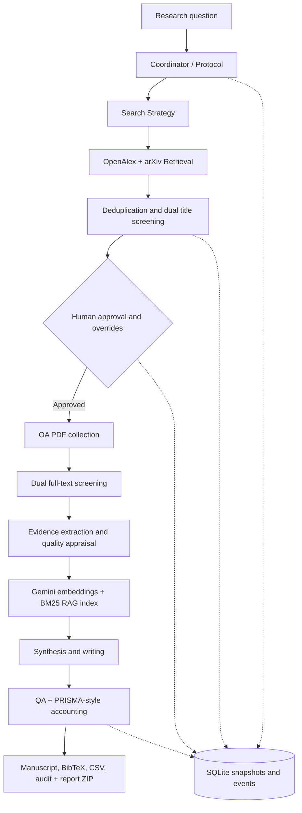

# Agentic Scientific Review AI

**Module:** M1 — Agentic AI & Building AI Agents  
**Team:** Mohammed Acharki, Imad Boulakhrif, Chaimae Boulakhrif  
**Team size:** 3 (within the five-student maximum)  
**University:** Université Abdelmalek Essaâdi  
**Faculty:** Faculté des Sciences et Techniques de Tanger (FSTT)  
**GitHub repository:** https://github.com/AcharkiMd/agentic-scientific-review-ai

> Team responsibility areas in this package are **proposed** until each member performs and documents the work. The offline synthetic demonstration is not a real scientific review. See `docs/team/TEAM_SUBMISSION_GUIDE.md` for submission instructions and personalized documentation.


**PRISMA-aligned, human-supervised systematic-review research prototype**  
**Stack:** Python · LangGraph · Google Gemini · hybrid RAG (Gemini embeddings + BM25) · SQLite · Streamlit · OpenAlex · arXiv · PyMuPDF

> **Scientific integrity notice.** This is an educational prototype, **not** a validated autonomous systematic-review tool. Its `demo` mode uses **fabricated publications** and simple rule-based decisions, not actual Gemini calls or academic literature. No synthetic review finding should be cited in scientific work. The `live` mode requires independent human methodological review of all screening, evidence, and synthesized claims. The flow diagram is PRISMA-style and does not certify PRISMA 2020 compliance.

## 1. Capabilities

1. **Coordinator / Planner:** structured review protocol and eligibility criteria.
2. **Search Strategy Agent:** Gemini-generated scholarly searches, tracked per query/source.
3. **Retrieval Agent:** OpenAlex + arXiv (metadata, deduplication, safe PDF ingestion).
4. **Independent screening reviewers:** two separately elicited decisions at title/abstract and full-text stages, recorded with rationales; disagreements surface as `uncertain`.
5. **Extraction and Appraisal Agent:** methods, findings, limitations, generic quality concerns, source quote validation.
6. **RAG:** local persistent chunk/vectors index, Gemini semantic embeddings + BM25 fusion; demo swaps Gemini embeddings for lexical hashing explicitly.
7. **Synthesis and Writing Agent:** evidence-linked themes and narrative manuscript.
8. **Critic / QA Agent:** deterministic reproducibility and citation/evidence checks with caveats.
9. **Human-in-the-loop:** protocol approval and auditable screening overrides before analysis proceeds.
10. **Persistence:** SQLite run snapshots, increasing versions, audit events; generated file checksums.

## 2. Setup

### Requirements

- Python **3.11+** (Python 3.12 recommended for class/lab environments)
- Internet and a valid Google Gemini API key **for live mode only**
- Optional OpenAlex API key or contact email; OpenAlex terms/rate limits may change
- The packages from `pyproject.toml` (download required at installation time)

### Windows PowerShell

```powershell
Expand-Archive .\Agentic_Scientific_Review_AI_Complete_Project.zip -DestinationPath .\project
Set-Location .\project\agentic-scientific-review-ai
py -3.12 -m venv .venv
.\.venv\Scripts\Activate.ps1
python -m pip install --upgrade pip
python -m pip install -e ".[test]"
Copy-Item .env.example .env
```

To start the UI:

```powershell
streamlit run app.py
```

### Linux/macOS

```bash
python3 -m venv .venv
source .venv/bin/activate
python -m pip install --upgrade pip
python -m pip install -e '.[test]'
cp .env.example .env
streamlit run app.py
```

**Never commit `.env` or paste API keys into public project logs.** To use Gemini live mode, edit `.env` and set `GEMINI_API_KEY=...`. The default text model is `gemini-2.5-flash`; the embedding model is `gemini-embedding-001`. Change these environment variables if your Google API account supports a different model. API usage may incur cost.

## 3. Run the 100% offline synthetic demonstration

```bash
reviewai demo
# Alternative without installing the entry point after installing dependencies:
python -m reviewai.cli demo
```

This runs the complete workflow on seven **invented** records; the synthetic fixture accepts only topics containing **lakehouse** (including a duplicate and a missing full text), automatically approves its *synthetic* protocol, and writes outputs to `data/runs/<RUN_ID>/`. This path verifies software control flow without an external API key.

Expected fixture structure:
- 7 raw retrieved synthetic records, 1 duplicate removed, 6 title/abstract screened.
- 4 reports sought, 1 full text unavailable, 3 included.
- The fixture may yield an artificial screening F1 of 1.0. This is *not* evidence of real scientific accuracy.

## 4. Run a live Gemini review (requires external connectivity)

### UI

```bash
streamlit run app.py
```

1. Choose **Live Gemini + academic APIs**.
2. Enter a research question and set the maximum paper count.
3. Click **Generate protocol, search and title-screen**.
4. Examine the proposed protocol, actual retrieval log and screening decisions. Resolve uncertain decisions via **human override**.
5. Explicitly approve and click **Approve and finish full-text review**.
6. Read the report and QA warnings; export a ZIP from the UI.

### CLI

```bash
reviewai prepare --mode live --topic "What approaches improve the scalability of lakehouse data architectures?" --max-papers 12
# Capture RUN_ID from output; inspect each screening decision.
reviewai status RUN_ID
reviewai override RUN_ID PAPER_ID include --reason "Confirmed eligibility using full abstract"
reviewai continue RUN_ID --approve
reviewai export RUN_ID
reviewai evaluate RUN_ID
```

The CLI refuses to continue without human approval. An undecided title-screening case must be resolved with an explicit override; a full-text disagreement is retained as unresolved and is **not** included in the evidence synthesis.

**What live mode actually does:** Gemini plans/searches/screens/extracts/synthesizes; OpenAlex and arXiv provide metadata; accessible OA PDFs are parsed; the review is restricted to available full-text evidence. A blocked PDF, source outage or unavailable abstract is explicitly recorded instead of fabricated.

**Limits:** source connectors do not cover every research database, Boolean query mappings can differ across sources, publication-year constraints may require additional validation, and no domain-specific risk-of-bias framework or statistical meta-analysis is automatically implemented. The model can make mistakes despite citation checks. Search scope is capped for practical MVP execution.

## 5. Main deliverables

The final `data/runs/<id>/` directory includes:

| Artifact | Function |
|---|---|
| `systematic_review.md` | Structured draft manuscript with PRISMA counts and evidence table |
| `protocol.json` | Approved protocol |
| `search_log.json` | Per-query/source outcomes and deduplication counts |
| `papers.json` | Retrieved and normalized metadata; full-text status |
| `title_screening.csv` | Two reviewer decisions, rationale, conflict and human override |
| `fulltext_screening.csv` | Full-text eligibility records |
| `evidence_table.csv` | Extraction, quality concerns, evidence quote verification |
| `human_gold_template.csv` | Blank independent screening labels for manual benchmarking |
| `evidence_map.json` | Theme-to-included-paper mapping |
| `references.bib` | Citation metadata; demo references explicitly labelled fabricated |
| `rag/` | Persisted chunks, embeddings and index metadata |
| `rag_evidence.json` | Retrieved source passages and fused relevance scores |
| `prisma_counts.json`, `prisma_flow.svg` | PRISMA-style totals and diagram |
| `qa.json` | Automated checks and scientific caveats |
| `audit_trail.json`, `state.json`, `manifest.json` | Audit, complete state, SHA-256 checksums |
| `evaluation.json` | Synthetic fixture metrics or human-ground-truth evaluation metadata (when evaluated) |

Further files: `TECHNICAL_REPORT.md`, `DEMO_SCRIPT.md`, `CONTRIBUTIONS.md`, and `docs/TEST_REPORT.md`.

## 6. Tests and verified status

```bash
python -m pytest -q
python -m compileall -q src app.py
```

Offline tests cover: SQLite state/approval/overrides, protocol validation, dual screening, deduplication, OpenAlex/arXiv parsing with mocked responses, partial search failure, PDF parsing, vector persistence/retrieval, PRISMA arithmetic, outputs, CLI, evaluator, and end-to-end fixture runs.

**External verification you must still perform:** install LangGraph, google-genai and Streamlit in your own environment; launch the UI; run with a valid Gemini key; confirm live OpenAlex/arXiv/PDF behavior; evaluate scientific quality against a human-reviewed reference set. The repository does **not** contain a fabricated claim that those live tests passed.

## 7. Architecture and data flow



- **Prepare graph:** coordinator_protocol -> search_strategy -> retrieval -> dual_title_screening.
- **Complete graph:** fulltext_retrieval -> dual_fulltext_screening -> evidence_extraction_appraisal -> hybrid_rag_synthesis -> prisma_and_critic.
- When LangGraph is unavailable, **only demo mode** permits a clearly labelled sequential execution fallback, so fixture tests remain executable in restricted environments. **Live mode refuses this fallback.**
- SQLite persists node-level state snapshots and audit entries; it is not an integrated LangGraph checkpoint saver. A failed run preserves its last snapshot for examination but does not automatically replay incomplete nodes.

## 8. Evaluation protocol

`reviewai evaluate RUN_ID` reports only verifiable metrics. The synthetic test can compute precision, recall, F1 and inter-reviewer agreement using the fixture's hidden `gold_label`s. Without an independent human-labelled dataset, it intentionally reports **no** live screening F1.

To evaluate live screening accuracy, fill the automatically exported `human_gold_template.csv`
with independent human labels (`include` or `exclude`) and then run:

```bash
reviewai evaluate RUN_ID --gold-csv data/runs/RUN_ID/human_gold_template.csv
```

Do not label by copying the AI decisions. Unlabelled rows are ignored. Inter-reviewer agreement and Cohen's kappa are calculated separately from human-ground-truth accuracy.

To measure time savings, record a real manual baseline for a *comparable review workload* and pass it to `reviewai evaluate RUN_ID --manual-minutes 90`. Do not use hypothetical baselines.

For a credible academic evaluation: select 20–30 real papers, label title/full-text decisions by two human reviewers, adjudicate disagreements, manually verify source quotes and extractions, and calculate independent screening accuracy, extraction fidelity, citations and coverage. The generic quality score is **not** a validated clinical risk-of-bias tool.

## 9. Security and scope

- Only HTTPS global-public destinations are eligible for automatic PDF retrieval; redirects and non-PDF/oversized files are rejected by default.
- PDFs are processed with bounded size/page/text limits and are never executed as instructions.
- Remote retrieval and model calls have costs and risks; do not submit secrets or confidential/unlicensed corpora without authorization.
- These safeguards are prototype-level. A production implementation would also need stronger networking controls, retries, user authentication, rate-limit handling, encrypted storage, and security review.

## 10. Submission guidance

The professor requires a GitHub/GitLab source repository, a README explaining installation/configuration/execution/usage, a **video no longer than 3 minutes**, and a team of **no more than five** with **individual contributions** in the final report. The generated ZIP is a local source-code archive, **not a remote GitHub submission**.

Read `DEMO_SCRIPT.md` for a timed demonstration and `CONTRIBUTIONS.md` for truthful team contribution documentation. You must verify and report genuine contributions and scientific review validity yourself.

## 11. References and developer documentation

- [LangGraph StateGraph documentation](https://reference.langchain.com/python/langgraph/graph/state/StateGraph)
- [Google Gen AI Python SDK](https://googleapis.github.io/python-genai/)
- [OpenAlex API documentation](https://help.openalex.org/api/)
- [OpenAlex search syntax](https://help.openalex.org/api/searching/)
- [PRISMA 2020 Statement](https://www.prisma-statement.org/prisma-2020)
- [arXiv API user manual](https://info.arxiv.org/help/api/user-manual.html)

## 12. License

MIT License (`LICENSE`).
